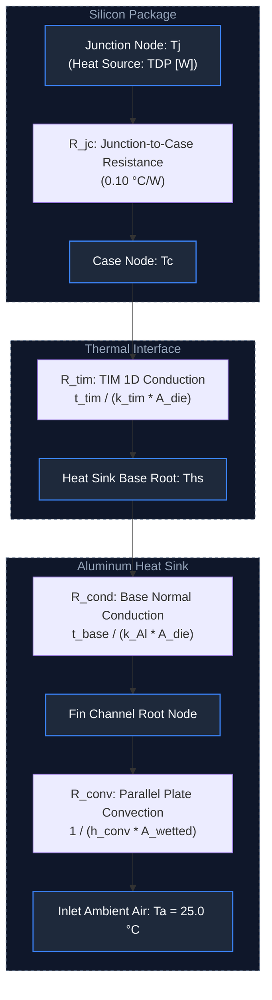
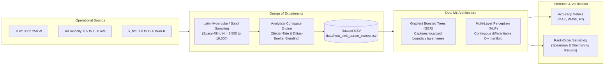

# Physics-Informed ML Surrogate Modeling for Forced-Convection Heat Sinks

A conjugate thermal-fluid modeling framework and machine learning surrogate pipeline for air-cooled electronic packages.

This repository couples analytical 1D/quasi-2D transport phenomena with Latin Hypercube Sampling (LHS) and Sobol space-filling designs to train Gradient Boosted Decision Trees (GBDT) and Multi-Layer Perceptrons (MLP).

The surrogates predict junction temperatures and total thermal impedance across multi-variable operational domains in sub-millisecond execution times.

---

## 1. System Overview & Thermal Resistance Architecture

Heat dissipated at the silicon junction passes through internal package interfaces, the thermal interface material (TIM), and the conductive heat sink baseplate before entering parallel plate fin channels via forced convection.

### Thermal Resistance Network



---

## 2. Machine Learning & Surrogate Pipeline

The modeling pipeline integrates physics-based analytical calculations, structured design-of-experiments sampling, and machine learning surrogate development.

### End-to-End Workflow



---

## 3. Benchmark Accuracy

**Test Split: 20%**

The following table summarizes the predictive performance of both surrogate architectures across the target thermal outputs.

| Target Output | Surrogate Architecture | MAE | RMSE | R² Score | Max Error Margin |
|:---|:---|---:|---:|---:|---:|
| R_total (°C/W) | Gradient Boosting (GBR) | 0.00056 | 0.00106 | 0.9983 | < 0.35% |
| R_total (°C/W) | Multi-Layer Perceptron (MLP) | 0.00352 | 0.00456 | 0.9682 | < 1.40% |
| T_junction (°C) | Gradient Boosting (GBR) | 0.363 °C | 0.595 °C | 0.9981 | < 0.85 °C |
| T_junction (°C) | Multi-Layer Perceptron (MLP) | 0.567 °C | 0.975 °C | 0.9950 | < 1.65 °C |

---

## 4. Repository Structure

```text
heat-sink-thermal-surrogate-ml/
│
├── README.md
│   └── Architecture overview, pipeline, and quickstart
│
├── SUMMARY_REPORT.md
│   └── Technical summary report and physical sensitivity analysis
│
├── audit_notes.md
│   └── Physics reconciliation (R_cond inclusion, area fixes)
│
├── requirements.txt
│   └── Pinned project dependencies
│
├── data/
│   └── heat_sink_param_sweep.csv
│       └── Evaluated Design of Experiments dataset
│
├── notebooks/
│   └── thermal_surrogate_modeling.ipynb
│       └── Interactive analysis, parity plots, and response surfaces
│
├── written_responses/
│   └── task responses
│
└── src/
    ├── __init__.py
    │   └── Package entry
    │
    ├── analytical_model.py
    │   └── Analytical conjugate heat transfer engine
    │
    ├── param_sweep.py
    │   └── Latin Hypercube and Sobol sequence DoE generator
    │
    ├── train_surrogates.py
    │   └── Dual ML architecture training and benchmarking
    │
    └── sensitivity.py
        └── Spearman rank-order correlation and trade-off screening
```

---

## 5. Quickstart & Execution

### 5.1. Environment Setup

Clone the repository and navigate to the project directory:

```bash
git clone https://github.com/Akileshkr01/heat-sink-thermal-surrogate-ml.git

cd heat-sink-thermal-surrogate-ml
```

Create and activate a virtual environment.

**Windows:**

```bash
python -m venv venv
venv\Scripts\activate
```

**Linux/macOS:**

```bash
python -m venv venv
source venv/bin/activate
```

Install the required dependencies:

```bash
pip install -r requirements.txt
```

### 5.2. Analytical Engine Verification

Verify the baseline physical calculations against analytical benchmark cases:

| Parameter | Baseline Value |
|:---|---:|
| TDP | 150 W |
| Air Velocity | 1.0 m/s |
| TIM Thermal Conductivity (k_tim) | 4.0 W/m·K |

Execute:

```bash
python -m src.analytical_model
```

### 5.3. Generate Parameter Sweep

Generate the Design of Experiments dataset using Latin Hypercube Sampling:

```bash
python -m src.param_sweep --samples 2500 --method lhs --output data/heat_sink_param_sweep.csv
```

### 5.4. Train Surrogate Models

Train the Gradient Boosting and Multi-Layer Perceptron surrogate models:

```bash
python -m src.train_surrogates --data data/heat_sink_param_sweep.csv
```

### 5.5. Run Global Sensitivity Screening

Perform Spearman rank-order correlation and trade-off analysis:

```bash
python -m src.sensitivity --data data/heat_sink_param_sweep.csv
```

### 5.6. Interactive Visualizations

Open the Jupyter notebook for interactive analysis, including:

- Model parity plots
- Residual density distributions
- 2D response contours

Launch the notebook:

```bash
jupyter notebook notebooks/thermal_surrogate_modeling.ipynb
```

---

## 6. Technical Citations

1. Incropera, F. P., DeWitt, D. P., Bergman, T. L., & Lavine, A. S. (2007). *Fundamentals of Heat and Mass Transfer* (6th ed.). John Wiley & Sons.

2. Kraus, A. D., & Bar-Cohen, A. (1995). *Design and Analysis of Heat Sinks*. John Wiley & Sons.

3. Sieder, E. N., & Tate, G. E. (1936). Heat Transfer and Pressure Drop of Liquids in Tubes. *Industrial & Engineering Chemistry*, 28(12), 1429–1435.

---

**Physics-Informed Thermal Modeling | Design of Experiments | Machine Learning Surrogates | Global Sensitivity Analysis**